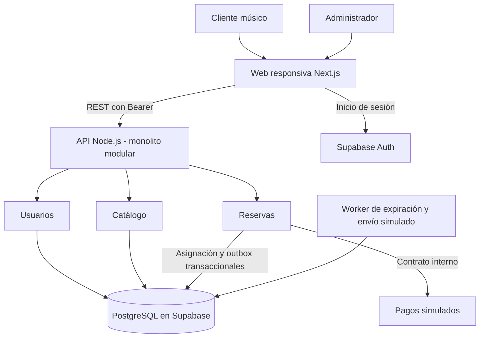

# Arquitectura del sistema - Sprint 2

La propuesta inicial se concretó en una aplicación Next.js con API REST y un worker del mismo código. Supabase aporta identidad y PostgreSQL. Pagos y mensajería son simulados.

Las flechas representan colaboración en ejecución. No son dependencias de importación. El worker corre en una segunda terminal y no constituye un nuevo módulo de negocio.

La descripción anterior al Sprint 2 se conserva en [la referencia histórica](../docs/sprint-1-referencia/02-arquitectura-software/arquitectura-inicial.md). Consultar [la arquitectura implementada](../docs/sprint-2/ARQUITECTURA.md) para transacciones, caché y límites.
