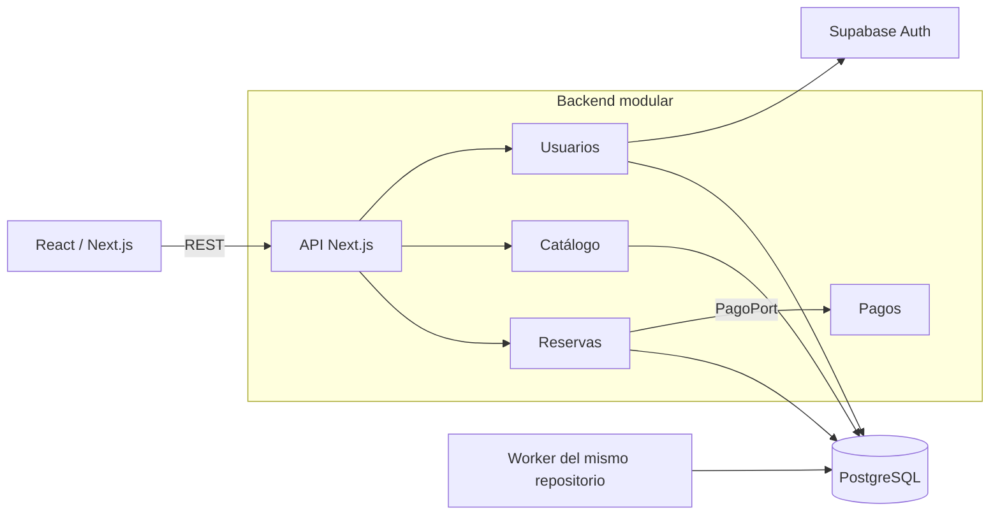

# Estilo arquitectónico - Monolito modular

El backend conserva cuatro módulos: Usuarios, Catálogo, Reservas y Pagos. Se ejecuta como una aplicación Node.js/Next.js, con un worker periódico del mismo código. Supabase gestiona PostgreSQL y autenticación; su uso no convierte la API Node.js en serverless.

La elección responde al desarrollo individual y bajo costo operativo (RC01, DA02 y ADR-001). Se mantienen llamadas internas entre módulos y puertos para aislar proveedores; no hay peticiones HTTP entre microservicios propios.

La unidad de despliegue es el repositorio de aplicación. En la demostración local hay dos procesos: servidor y worker. El alojamiento público queda fuera del alcance acordado. Las simulaciones de pago y envío están identificadas en la interfaz y API.

Detalle: [arquitectura y datos](../docs/sprint-2/ARQUITECTURA.md). [Propuesta previa conservada](../docs/sprint-1-referencia/02-arquitectura-software/estilo-arquitectonico.md).
