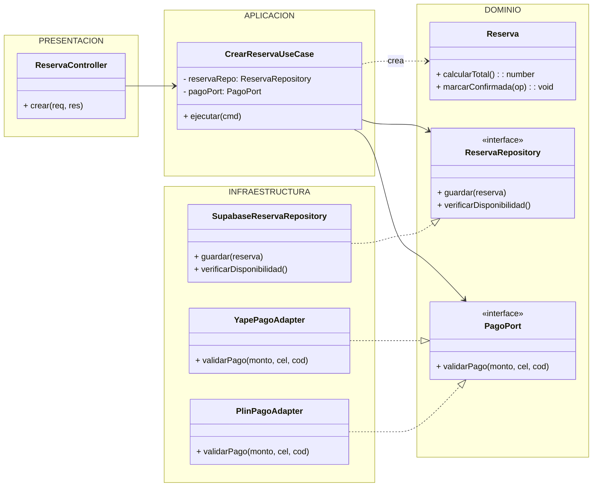

# Principios de diseño (SOLID)

## Objetivo

Documentar cómo se aplican los principios SOLID en el backend de la App de Reservas de Salas de Ensayo en Ayacucho, organizado con Clean Architecture, para que cada módulo se programe de forma uniforme y las reglas de negocio (como el anti-overbooking) no dependan de la tecnología.

## Contexto

- **Estilo:** Monolito modular (Node.js / TypeScript / Supabase).
- **Enfoque interno:** Clean Architecture (Presentación, Aplicación, Dominio, Infraestructura).
- **Módulo de referencia:** Reservas, porque integra base de datos relacional y pasarela de pagos externos (Yape/Plin).

## Diagrama: Principios SOLID aplicados en el módulo Reservas

## SOLID en el módulo Reservas

| Principio | Dónde se aplica (capa) | Cómo se cumple en el Sistema de Reservas | Archivos |
|---|---|---|---|
| **S** · Responsabilidad única | Todas las capas | Cada clase tiene una sola tarea: el controlador recibe la petición HTTP, el caso de uso coordina la reserva, la entidad aplica la regla anti-overbooking y el repositorio guarda en PostgreSQL (Supabase) | `reserva.controller.ts`, `crear-reserva.use-case.ts`, `reserva.ts`, `supabase-reserva-repository.ts` |
| **O** · Abierto/cerrado | Infraestructura | Para agregar una nueva pasarela (ej. Plin o Niubiz) se crea un nuevo adaptador; el caso de uso de crear reserva no se modifica | `yape-pago.adapter.ts`, `plin-pago.adapter.ts` |
| **L** · Sustitución de Liskov | Infraestructura | Yape y Plin devuelven la misma estructura `{ aprobado, numOperacion }`; el caso de uso funciona exactamente igual con cualquiera de los dos | `yape-pago.adapter.ts`, `plin-pago.adapter.ts` |
| **I** · Segregación de interfaces | Dominio | Cada interfaz tiene solo lo que Reservas necesita: `PagoPort` solo valida pagos, `ReservaRepository` solo guarda y verifica disponibilidad de salas | `pago-port.ts`, `reserva-repository.ts` |
| **D** · Inversión de dependencias | Aplicación | El caso de uso recibe interfaces por el constructor y no conoce Supabase ni la API de Yape; las implementaciones se conectan en `reservas.module.ts` | `crear-reserva.use-case.ts`, `reservas.module.ts` |

## Qué pasaría sin SOLID en el Sistema de Reservas

| Situación real | Sin SOLID | Con SOLID |
|---|---|---|
| Se agrega Plin además de Yape | Hay que modificar y llenar de condicionales (`if/else`) el caso de uso | Solo se crea un nuevo adaptador `PlinPagoAdapter` |
| Se cambia Supabase por otro BaaS | Se rompe y reescribe toda la lógica del módulo | Solo se reemplaza `SupabaseReservaRepository` |
| Se quiere probar la lógica de reservas | Se necesita conexión a internet, Supabase y la API real | Se prueba en milisegundos con objetos falsos en memoria |
| Cambia la regla del mínimo de horas | Hay que buscarla por controladores y rutas | Está aislada de forma segura en la entidad `Reserva` |

## Relación con Clean Architecture y los patrones

| Principio | Lo cumple en el proyecto |
|---|---|
| Responsabilidad única | La estricta separación en capas de Clean Architecture |
| Abierto/cerrado y Liskov | El patrón Adapter (para validación de pagos) |
| Segregación de interfaces | Los puertos declarados en el dominio (`PagoPort`, `ReservaRepository`) |
| Inversión de dependencias | El patrón Repository y la regla de dependencia: las capas externas dependen del dominio y no al revés |
