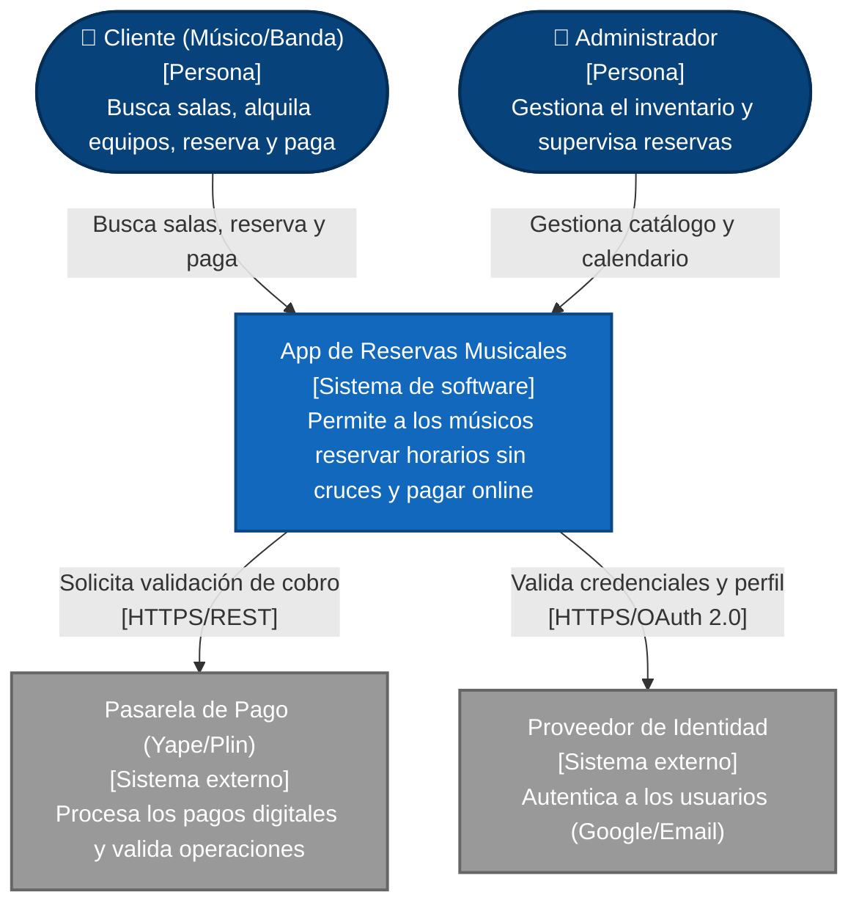

# Nivel 1 · Diagrama de contexto del sistema

> **Proyecto:** App Web de Reservas de Salas de Ensayo - Ayacucho  
> **Modelo:** C4 · Nivel 1 de 4 · **Versión:** 1.0

---

## 1. Objetivo

Mostrar la **App de Reservas como una sola caja**: quiénes la usan y con qué sistemas externos se comunica. Es la vista de mayor nivel y la primera que se presenta a cualquier persona (docentes, dueños del local, desarrolladores).

| Aspecto | Descripción |
|---|---|
| Pregunta que responde | ¿Qué es el sistema, quién lo usa y con quién se integra? |
| Audiencia | Todos: negocio, docentes, equipo de desarrollo |
| Qué **no** muestra | Tecnologías (React, Node, Supabase), bases de datos ni módulos internos |
| Siguiente nivel | `Nivel2-DiagramadeContenedores.md` |

---

## 2. Diagrama

---

## 3. Personas (usuarios)

| Persona | Descripción | Qué hace en el sistema |
|---|---|---|
| **Cliente (Músico/Banda)** | Usuario final que necesita ensayar | Consulta el calendario de salas, agrega equipos extra (baterías, cables), reserva un horario y realiza el pago online. |
| **Administrador** | Dueño o encargado del local de ensayo | Gestiona el inventario de salas y equipos (precios, stock), revisa las reservas del día y gestiona cancelaciones. |

---

## 4. Sistemas

| Sistema | Tipo | Responsabilidad | Quién lo construye |
|---|---|---|---|
| **App de Reservas Musicales** | Sistema en alcance | Permite a los clientes buscar disponibilidad en tiempo real, armar su reserva sin cruces de horarios y pagarla; permite al admin gestionar su local. | El equipo del proyecto (Solo Developer) |
| **Pasarela de Pago (Yape/Plin)** | Sistema externo | Procesa los pagos digitales y valida las operaciones. | Proveedor de pagos / Banco |
| **Proveedor de Identidad (Auth)** | Sistema externo | Autentica a los usuarios de forma segura (ej. Inicio de sesión con Google) para evitar fraudes. | Google / Supabase Auth |

---

## 5. Relaciones

| Origen | Destino | Descripción | Protocolo |
|---|---|---|---|
| Cliente | App de Reservas | Busca salas, alquila equipos, reserva y paga | — |
| Administrador | App de Reservas | Administra catálogo y visualiza calendario de reservas | — |
| App de Reservas | Pasarela de Pago | Solicita validación de cobro / Genera QR | HTTPS/REST |
| App de Reservas | Proveedor de Identidad | Valida credenciales y obtiene perfil del usuario | HTTPS/OAuth 2.0 |

> *Nota: En el nivel 1 no se indica el protocolo entre personas y sistema (ej. navegador web vs móvil); eso se detalla en el nivel 2.*

---

## 6. Decisiones y supuestos

| # | Decisión o supuesto | Motivo |
|---|---|---|
| 1 | Integración con pasarelas de pago externas | Por seguridad y facilidad de implementación, el sistema no almacena datos bancarios ni procesa tarjetas localmente. |
| 2 | Uso de un Proveedor de Identidad (SSO) | Para reducir la fricción al registrarse (los músicos usan su cuenta de Google) y delegar la seguridad de las contraseñas. |
| 3 | El sistema prioriza el acceso móvil (Mobile-First) | El usuario "Cliente" accederá predominantemente desde su celular al momento de coordinar con su banda. |

### Pendientes por definir

| Tema | Detalle |
|---|---|
| Notificaciones externas | Falta definir si el sistema enviará correos electrónicos (ej. SendGrid) o mensajes automatizados por WhatsApp al confirmar la reserva. Si se elige un proveedor, se agregará como "Sistema Externo" en este diagrama. |
| Facturación electrónica | Evaluar con el negocio si más adelante será necesario integrar una API de la SUNAT para emitir boletas electrónicas de forma automática. |