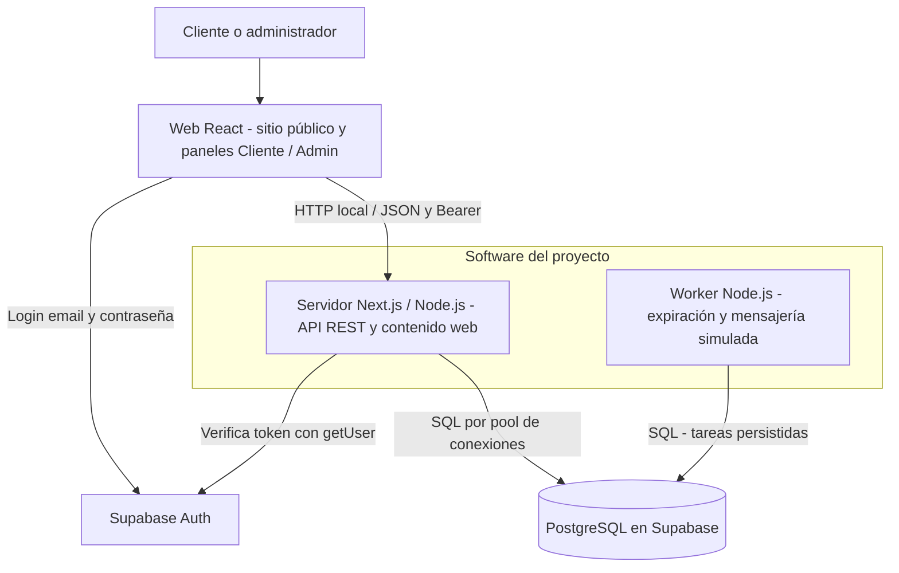

# C4 nivel 2 - Contenedores implementados

La aplicación web y las rutas API se construyen en un proyecto Next.js. El worker es un segundo proceso del mismo repositorio, no un microservicio de negocio. En operación se usa Supabase gestionado; las pruebas automatizadas utilizan PostgreSQL temporal aislado. HTTP se limita a localhost; un despliegue público debe terminar TLS.

El navegador mantiene una sesión compartida y componentes de presentación separados por rol. El detalle de rutas, guardas y componentes se documenta en [interfaces del Sprint 2](../docs/sprint-2/INTERFACES.md). Es una separación dentro del mismo contenedor, sin cambiar el backend ni las transacciones.

El navegador accede a datos de negocio exclusivamente mediante la API. RLS y revocaciones bloquean el acceso directo a tablas. La conexión de servidor es privilegiada y la autorización se aplica en la API con rol y propiedad. Pagos y envío son simulados dentro del software propio.

[Anterior: contexto](nivel_1_diagrama_de_contexto.md). [Siguiente: componentes](nivel_3_diagrama_de_componentes.md). [Vista previa conservada](../docs/sprint-1-referencia/04-modelo-c4/nivel_2_diagrama_de_contenedores.md).
