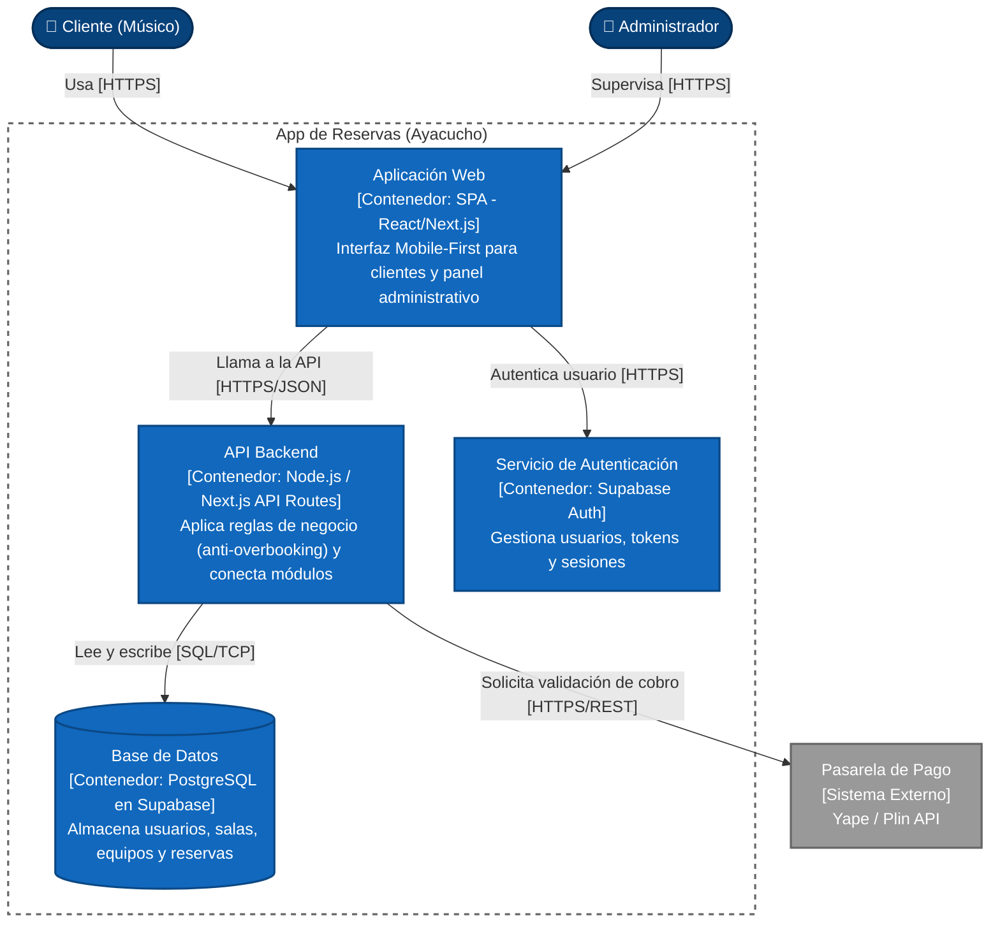

# Nivel 2 · Diagrama de contenedores

> **Proyecto:** App Web de Reservas de Salas de Ensayo - Ayacucho  
> **Modelo:** C4 · Nivel 2 de 4 · **Versión:** 1.0

---

## 1. Objetivo

Abrir la caja «App de Reservas» del Nivel 1 y mostrar los **contenedores** que la forman: las aplicaciones web, las APIs y los almacenes de datos que se ejecutan por separado, indicando la tecnología de cada uno y cómo se comunican.

| Aspecto | Descripción |
|---|---|
| Pregunta que responde | ¿De qué piezas ejecutables se compone el sistema y con qué tecnología? |
| Audiencia | Arquitectos, desarrolladores, operaciones |
| Qué es un contenedor | Algo que se ejecuta o almacena datos de forma independiente (Frontend, Backend, Base de Datos). |
| Nivel anterior | `Nivel1-DiagramadeContextodelSistema.md` |
| Siguiente nivel | `Nivel3-Diagrama-de-Componentes.md` |

---

## 2. Diagrama

---

## 3. Contenedores

| Contenedor | Tecnología | Responsabilidad | Datos que maneja |
|---|---|---|---|
| **Aplicación web** | React.js / Next.js (Tailwind) | Interfaz Mobile-First para clientes (calendario, carrito) y panel para administradores. | Ninguno persistente; solo estado temporal de la pantalla (carrito local). |
| **API Backend** | Node.js (Next.js API Routes) | Monolito modular. Expone la API REST, aplica las reglas anti-overbooking y calcula precios. | Ninguno propio; transita datos entre el frontend y Supabase. |
| **Servicio de Autenticación** | Supabase Auth (BaaS) | Verifica identidades y emite tokens JWT (Google SSO, Email/Pass). | Credenciales encriptadas y sesiones activas. |
| **Base de datos** | PostgreSQL (Supabase BaaS) | Almacena de forma permanente y relacional la información del negocio con estricta integridad. | Usuarios, Salas, Equipos, Reservas y Detalle de Reservas. |

---

## 4. Relaciones

| Origen | Destino | Descripción | Protocolo |
|---|---|---|---|
| Cliente / Administrador | Aplicación web | Usan la aplicación desde el navegador web (móvil o PC). | HTTPS |
| Aplicación web | Servicio Auth | Inicia sesión y obtiene token de seguridad (JWT). | HTTPS |
| Aplicación web | API Backend | Envía solicitudes de reserva o consulta catálogo. | HTTPS/JSON |
| API Backend | Base de datos | Verifica disponibilidad y guarda reservas confirmadas. | SQL sobre TCP |
| API Backend | Pasarela de Pago (Yape) | Solicita la validación del pago o la generación del QR. | HTTPS/REST |

---

## 5. Decisiones arquitectónicas reflejadas

| Decisión | Alternativa descartada | Motivo |
|---|---|---|
| **Uso de Backend-as-a-Service (Supabase)** | Crear servidor y BD en AWS/DigitalOcean desde cero | Al ser un "Solo Developer", se delega la infraestructura (Auth y BD) para ahorrar tiempo y costos operativos iniciales. |
| **Frontend separado del backend (React API)** | Vistas generadas en el servidor (Ej. EJS/PHP) | Permite que el frontend sea 100% responsivo y rápido (Mobile-First), comportándose casi como una app nativa. |
| **PostgreSQL como base de datos** | Base de datos NoSQL (MongoDB/Firebase) | El motor de reservas y los pagos requieren transacciones estrictas ACID para prevenir el overbooking. |
| **API Centralizada** | Acceso directo de React a la Base de Datos | Por seguridad y para aplicar Clean Architecture, las reglas de negocio críticas deben ejecutarse en el servidor (API Backend). |

---

## 6. Seguridad entre contenedores

| Comunicación | Medida |
|---|---|
| Navegador → Aplicación web y API | Tráfico cifrado en todo momento con certificado SSL (HTTPS). |
| Aplicación web → API Backend | Validación del token JWT en cada petición mediante middlewares (Supabase Auth). |
| API Backend → Base de datos | Las políticas *Row Level Security (RLS)* garantizan que un músico solo pueda ver y modificar sus propias reservas. |
| API Backend → Pasarela de pago | Las credenciales (API Keys) de Yape/Plin viven seguras en las variables de entorno del servidor. |