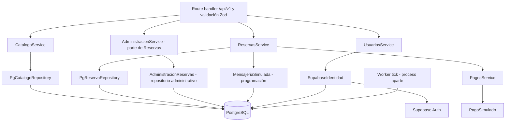

# C4 nivel 3 - Componentes del backend

La vista de componentes del frontend se encuentra en [Interfaces por rol](../docs/sprint-2/INTERFACES.md): autenticación y sesión, sitio público, reserva, cliente HTTP y paneles de cliente/administrador. Estos componentes consumen el backend de este diagrama; no se agregan módulos de negocio ni conexiones SQL en la web.

Las flechas indican colaboración en ejecución, no importaciones concretas. Los servicios dependen de contratos inyectados por composición. Módulos: Usuarios (perfiles y rol), Catálogo (recursos y tarifas), Reservas (asignación, estados y administración) y Pagos (proveedor financiero simulado). Mensajería sigue siendo un adaptador y un mecanismo de tareas de Reservas.

El repositorio de asignación coordina sala y equipos atómicamente y consulta sus tarifas dentro de la misma transacción. Esa excepción al límite de tablas entre módulos se justifica en [arquitectura](../docs/sprint-2/ARQUITECTURA.md). Todas las modificaciones de recursos y asignaciones comparten el protocolo de bloqueo.

[Anterior: contenedores](nivel_2_diagrama_de_contenedores.md). [Siguiente: código](nivel_4_diagrama_de_codigo.md). [Propuesta previa conservada](../docs/sprint-1-referencia/04-modelo-c4/nivel_3_diagrama_de_componentes.md).
