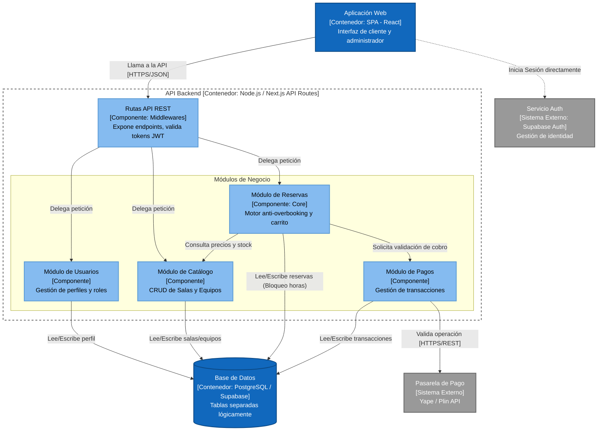

# Nivel 3 · Diagrama de componentes

> **Proyecto:** App Web de Reservas de Salas de Ensayo - Ayacucho  
> **Contenedor detallado:** API Backend (Monolito Modular)  
> **Modelo:** C4 · Nivel 3 de 4 · **Versión:** 1.0

---

## 1. Objetivo

Abrir el contenedor **API Backend** del nivel 2 y mostrar sus **componentes**: los módulos del monolito modular, la responsabilidad de cada uno, cómo se relacionan entre sí y cómo interactúan con la base de datos y la pasarela de pago.

| Aspecto | Descripción |
|---|---|
| Pregunta que responde | ¿Cómo se divide el backend por dentro y qué hace cada parte? |
| Audiencia | Arquitectos y desarrolladores |
| Qué es un componente | Un grupo de funcionalidades con una responsabilidad clara. En este proyecto, cada **módulo** lógico de negocio es un componente. |
| Nivel anterior | `Nivel2-DiagramadeContenedores.md` |
| Siguiente nivel | `Nivel4-DiagramadeCodigo.md` |

---

## 2. Diagrama

---

## 3. Componentes

| Componente | Responsabilidad | Funcionalidades principales | Carpeta en el código |
|---|---|---|---|
| **Rutas API REST** | Punto de entrada HTTP | Define las rutas (ej. `/api/reservas`), valida el token JWT de Supabase y redirige al módulo correcto. | `src/api/` |
| **Módulo Usuarios** | Identidad y acceso | Gestiona los perfiles de los músicos (bandas) y administradores del local. | `src/modulos/usuarios/` |
| **Módulo Catálogo** | Gestión de recursos | CRUD de Salas (capacidad, precio) y Equipos extras (baterías, platillos, cables). | `src/modulos/catalogo/` |
| **Módulo Reservas** | Motor de negocio (Core) | Algoritmo **anti-overbooking**, armado del carrito, cálculo de costos y confirmación de horas. | `src/modulos/reservas/` |
| **Módulo Pagos** | Cobros | Integración externa para validar pagos de Yape o Plin. | `src/modulos/pagos/` |

---

## 4. Relaciones entre componentes

| Origen | Destino | Descripción | Tipo de comunicación |
|---|---|---|---|
| Rutas API | Módulos de negocio | Invoca los Casos de Uso desde los controladores. | Llamada en memoria |
| Módulo Reservas | Módulo Catálogo | Consulta si un equipo está activo y su precio actual para calcular el total. | Llamada en memoria (Interfaces) |
| Módulo Reservas | Módulo Pagos | Envía el total a cobrar y espera la confirmación (código de operación). | Llamada en memoria (Interfaces) |

---

## 5. Relaciones con bases de datos y sistemas externos

| Componente | Destino | Descripción | Protocolo | Patrón aplicado |
|---|---|---|---|---|
| Todos los módulos | Base de Datos (PostgreSQL) | Cada módulo lee y escribe sus propias tablas mediante el cliente de Supabase. | SQL / TCP | Repository |
| Rutas API / Web | Servicio Auth (Supabase) | Verifica la validez del token de sesión. | HTTPS | Middleware |
| Módulo Pagos | Pasarela (Yape) | Solicita la validación del código de pago ingresado por el músico. | HTTPS/REST | Adapter |

---

## 6. Reglas del Monolito Modular

| # | Regla | Motivo |
|---|---|---|
| 1 | Todos los componentes se despliegan juntos. | Al ser un Monolito (Next.js/Node), se facilita el despliegue para un solo desarrollador, operando bajo un mismo servidor. |
| 2 | Un módulo se comunica con otro a través de puertos/interfaces. | Evita el acoplamiento fuerte. Si Catálogo cambia su base de datos, Reservas no se ve afectado. |
| 3 | Un módulo no hace un `SELECT` o `UPDATE` directo a las tablas de otro módulo. | Mantiene la integridad. Si Reservas necesita saber el precio de una sala, le "pregunta" al módulo Catálogo. |
| 4 | Clean Architecture interna. | Cada módulo (como Reservas) organiza su código en Dominio, Aplicación e Infraestructura (Ver Nivel 4). |
