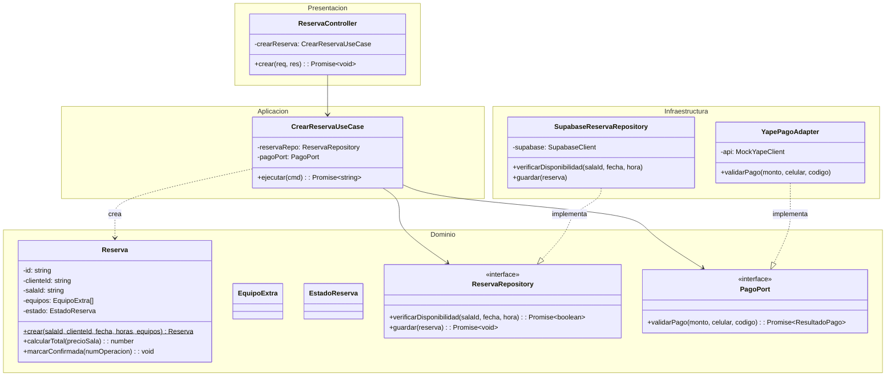
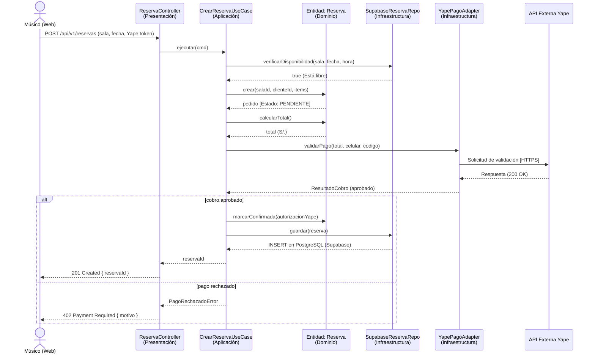

# Nivel 4 · Diagrama de código

> **Proyecto:** App Reservas Salas Ayacucho · **Módulos detallados:** Reservas y Pagos  
> **Modelo:** C4 · Nivel 4 de 4 · **Notación:** UML (Mermaid) · **Versión:** 1.0

---

## 1. Objetivo

Mostrar **cómo está organizado el código** de un componente clave (Módulo de Reservas): sus clases, interfaces y la forma en que colaboran. Se detalla el flujo **Crear Reserva**, que involucra las reglas de *anti-overbooking* y la integración con la pasarela de Yape.

| Aspecto | Descripción |
|---|---|
| Pregunta que responde | ¿Qué clases existen dentro de un módulo y cómo se relacionan? |
| Audiencia | Desarrolladores |
| Notación | UML (diagrama de clases y diagrama de secuencia usando código Mermaid) |
| Por qué solo estos módulos | El nivel 4 se dibuja solo para los componentes más críticos. Reservas concentra las reglas complejas de disponibilidad y el motor de cobros |
| Nivel anterior | `Nivel3-Diagrama-de-Componentes.md` |

---

## 2. Diagrama de Clases (Módulo Reservas)

El siguiente diagrama UML muestra la estructura interna del módulo aplicando Clean Architecture. Las flechas apuntan siempre hacia el Dominio (el centro).

### 2.1 Capas de Clean Architecture

| Capa | Contiene | Regla |
|---|---|---|
| **Presentación** | Controladores | Traduce JSON/HTTP de la app móvil a llamadas del caso de uso. |
| **Aplicación** | Casos de uso | Coordina el flujo (validar, cobrar, guardar); no conoce la BD ni APIs externas. |
| **Dominio** | Entidades, objetos de valor, interfaces | Contiene las reglas anti-overbooking y de negocio. |
| **Infraestructura** | Repositorios y adaptadores | Implementa las interfaces usando Supabase y la API de Yape. |

---

## 3. Diagrama de Secuencia: Flujo de Crear Reserva

Este diagrama ilustra el paso a paso desde que el músico envía su solicitud hasta que la reserva se guarda en la base de datos tras validar el pago.

---

## 4. Patrones y principios visibles en este nivel

| Elemento del diagrama | Patrón o principio |
|---|---|
| `YapePagoAdapter` | Patrón **Adapter** (Aísla la API externa del núcleo). |
| `ReservaRepository` y `SupabaseReservaRepository` | Patrón **Repository** (El negocio no sabe que se usa PostgreSQL/Supabase). |
| El `CrearReservaUseCase` recibe interfaces (`PagoPort`), no clases concretas | Principio de **Inversión de Dependencias** (Letra 'D' de SOLID). |
| Cada clase hace una sola cosa (Controlador responde HTTP, Entidad calcula total) | Principio de **Responsabilidad Única** (Letra 'S' de SOLID). |
