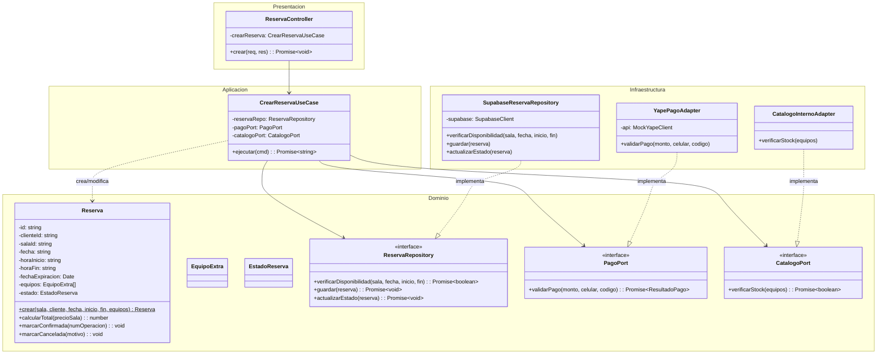
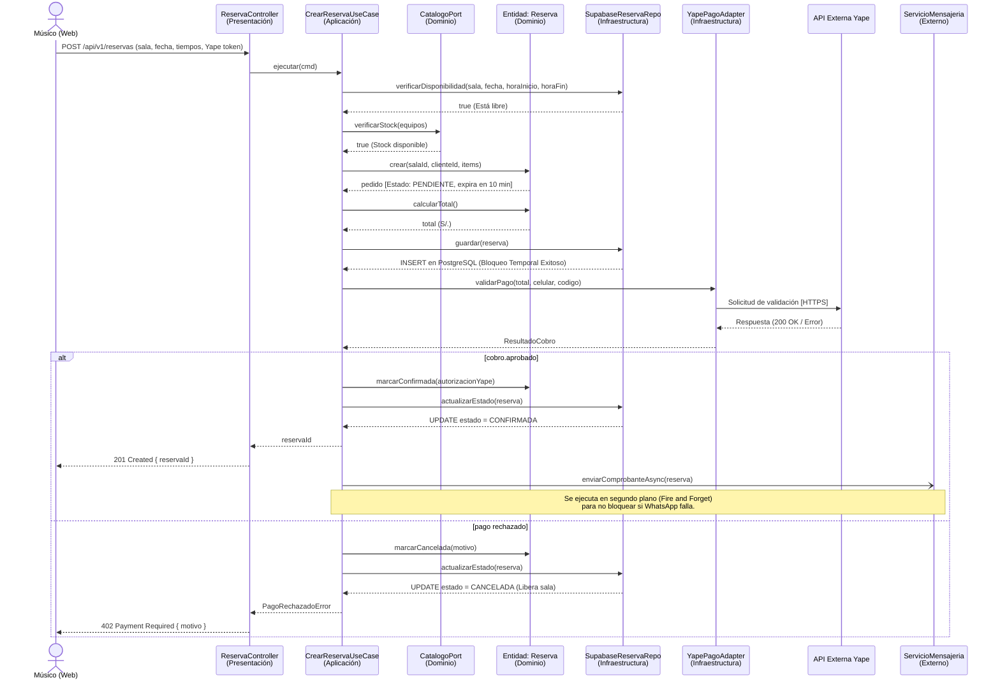

# Nivel 4 · Diagrama de código

> **Proyecto:** App Reservas Salas Ayacucho · **Módulos detallados:** Reservas y Pagos  
> **Modelo:** C4 · Nivel 4 de 4 · **Notación:** UML (Mermaid) · **Versión:** 1.1

---

## 1. Objetivo

Mostrar **cómo está organizado el código** de un componente clave (Módulo de Reservas): sus clases, interfaces y la forma en que colaboran. Se detalla el flujo **Crear Reserva**, que involucra las reglas de *anti-overbooking* transaccional y la integración con la pasarela de Yape.

| Aspecto | Descripción |
|---|---|
| Pregunta que responde | ¿Qué clases existen dentro de un módulo y cómo se relacionan? |
| Audiencia | Desarrolladores |
| Notación | UML (diagrama de clases y diagrama de secuencia usando código Mermaid) |
| Por qué solo estos módulos | El nivel 4 se dibuja solo para los componentes más críticos. Reservas concentra las reglas complejas de concurrencia y el motor de cobros |
| Nivel anterior | `Nivel3-Diagrama-de-Componentes.md` |

---

## 2. Diagrama de Clases (Módulo Reservas)

El siguiente diagrama UML muestra la estructura interna del módulo aplicando Clean Architecture. Las flechas apuntan siempre hacia el Dominio (el centro).

### 2.1 Capas de Clean Architecture

| Capa | Contiene | Regla |
|---|---|---|
| **Presentación** | Controladores | Traduce JSON/HTTP de la app móvil a llamadas del caso de uso. |
| **Aplicación** | Casos de uso | Coordina el flujo transaccional y verifica el stock mediante `CatalogoPort`; no conoce la BD ni APIs externas. |
| **Dominio** | Entidades, objetos de valor, interfaces | Contiene las reglas anti-overbooking y estados de negocio. |
| **Infraestructura** | Repositorios y adaptadores | Implementa las interfaces usando Supabase, la API de Yape y el módulo Catálogo. `SupabaseReservaRepository` delega el bloqueo de concurrencia a las restricciones de exclusión de PostgreSQL (`tsrange`). |

---

## 3. Diagrama de Secuencia: Flujo Transaccional de Crear Reserva

Este diagrama ilustra el paso a paso asegurando que la sala se bloquea temporalmente en la base de datos antes de contactar a la pasarela de pago, evitando condiciones de carrera.

---

## 4. Patrones y principios visibles en este nivel

| Elemento del diagrama | Patrón o principio |
|---|---|
| El flujo de Guardado Temporal | **Bloqueo Pesimista / Transaccional** (Evita reservas simultáneas). |
| `YapePagoAdapter` | Patrón **Adapter** (Aísla la API externa del núcleo). |
| `ReservaRepository` y `SupabaseReservaRepository` | Patrón **Repository** (El negocio no sabe que se usa PostgreSQL/Supabase). |
| `CatalogoPort` | Puerto del Dominio para verificar stock sin acoplar Reservas a la implementación de Catálogo. |
| El `CrearReservaUseCase` recibe interfaces (`ReservaRepository`, `PagoPort`, `CatalogoPort`), no clases concretas | Principio de **Inversión de Dependencias** (Letra 'D' de SOLID). |
| Cada clase hace una sola cosa (Controlador responde HTTP, Entidad calcula total) | Principio de **Responsabilidad Única** (Letra 'S' de SOLID). |
