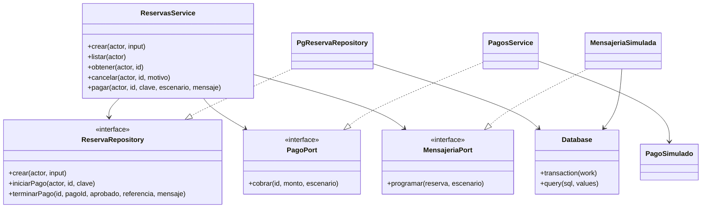
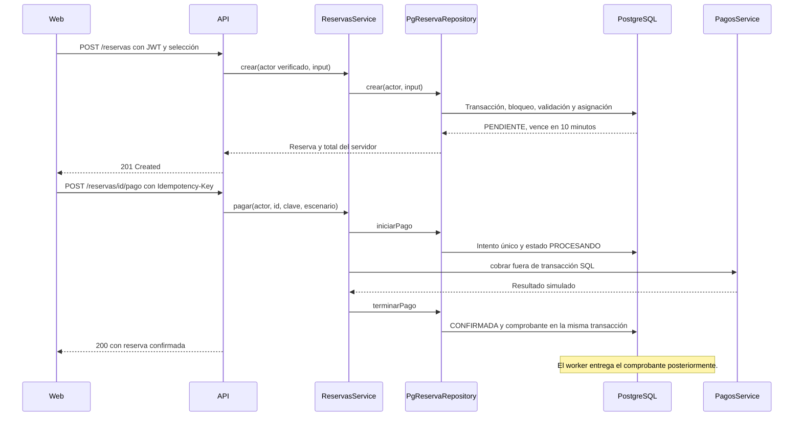

# C4 nivel 4 - Código de reservas implementado

Los nombres corresponden a archivos TypeScript ejecutables. `Reserva` es un tipo de datos; las reglas son funciones puras. No existe una clase Yape ni un cliente financiero real.

La secuencia muestra aprobación. Rechazo cancela y libera; resultado incierto conserva PROCESANDO hasta conciliación administrativa. La entrega del mensaje no participa en la respuesta de pago.

Fuentes ejecutables: [servicio](../src/modulos/reservas/aplicacion/reservas-service.ts), [contratos](../src/modulos/reservas/dominio/puertos.ts), [repositorio](../src/modulos/reservas/infraestructura/pg-reserva-repository.ts). [Diagrama previo conservado](../docs/sprint-1-referencia/04-modelo-c4/nivel_4_diagrama_de_codigo.md).
