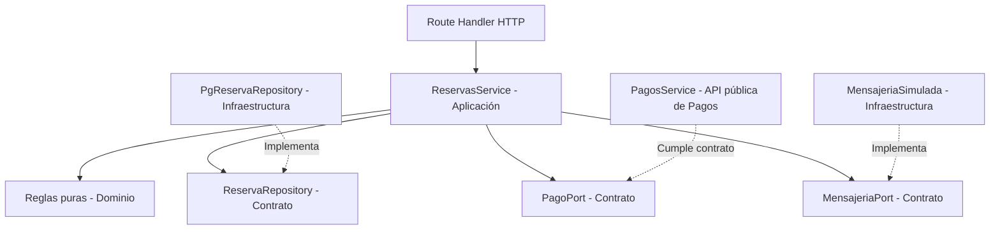

# Enfoque arquitectónico - Clean Architecture

El código se organiza por módulo y por responsabilidad: dominio, aplicación, infraestructura y presentación. Los servicios reciben contratos por constructor y la raíz de composición conecta las implementaciones. El núcleo no importa SDK de Supabase, PostgreSQL, React ni Next.js.

Las flechas continuas son dependencias hacia contratos internos; las discontinuas indican implementación estructural de interfaces TypeScript. `src/servidor/composicion.ts` conoce todas las capas para crear e inyectar dependencias.

`Reserva` es un tipo y sus reglas son funciones puras. El caso de uso inicial CrearReserva se materializa en `ReservasService.crear`, no en una clase copiada del ejemplo. La garantía de concurrencia pertenece a la persistencia, no a una entidad aislada.

La excepción transaccional para leer tarifas e inventario durante la asignación se documenta en [arquitectura implementada](../../../sprint-2/ARQUITECTURA.md). [Propuesta previa conservada](../../../sprint-1-referencia/02-arquitectura-software/enfoque/enfoque-arquitectonico.md).
