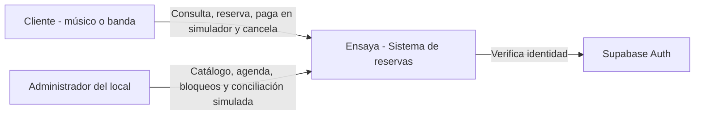

# C4 nivel 1 - Contexto implementado

**Sistema:** Reservas de Salas Ayacucho. **Versión:** Sprint 2.

El sistema atiende un local y dos roles. Incluye simulaciones de pago y mensajería internas: por ello no se dibujan como proveedores bancarios o de WhatsApp realmente conectados. La integración financiera y de envío real queda como evolución futura.

El nivel 1 no detalla tecnologías de las aplicaciones, SQL ni clases. [Siguiente: contenedores](nivel_2_diagrama_de_contenedores.md). [Contexto propuesto previamente](../../sprint-1-referencia/04-modelo-c4/nivel_1_diagrama_de_contexto.md).
