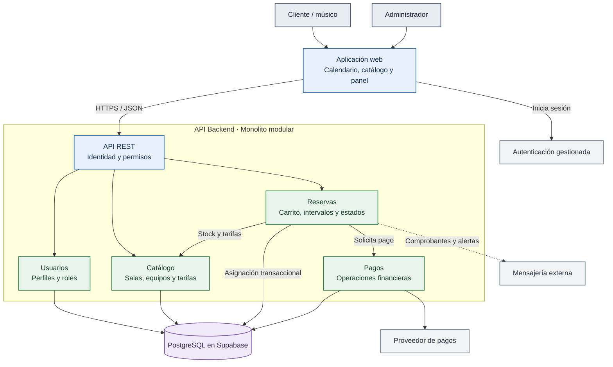

# Arquitectura inicial del sistema

## Diagrama de arquitectura

**Lectura:** flechas continuas = comunicación o colaboración; flecha discontinua = envío asíncrono. Azul = presentación/aplicación; verde = negocio; violeta = infraestructura; gris = personas o servicios externos. El diagrama representa una propuesta de diseño.
