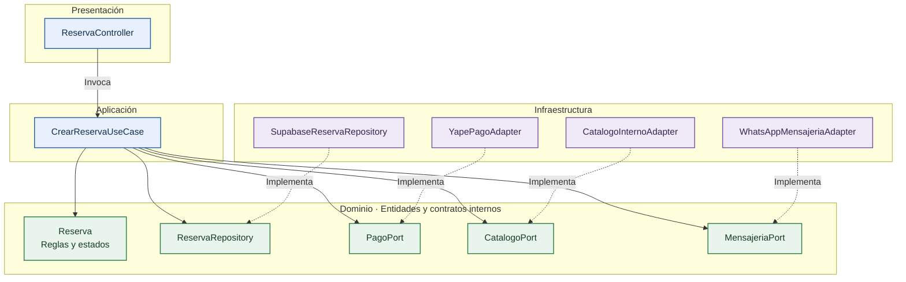

# Enfoque Arquitectónico: Clean Architecture

Para el desarrollo del sistema de reservas de salas de ensayo y equipos en Ayacucho, se ha seleccionado **Clean Architecture (Arquitectura Limpia)** como el patrón de diseño a nivel interno. 

Este enfoque organiza el sistema alrededor de las reglas de negocio y establece una **regla de dependencia estricta**: el código fuente solo puede apuntar hacia adentro, hacia el núcleo del dominio.

## Definición del Enfoque

| Elemento | Descripción aplicada al Sistema de Reservas |
| :--- | :--- |
| **Patrón / enfoque** | Clean Architecture (Arquitectura Limpia). |
| **Objetivo** | Separar las responsabilidades y controlar las dependencias para que el núcleo del negocio (el motor de reservas) no dependa de la base de datos, la interfaz o agentes externos. |
| **¿Qué problema resuelve?** | Evita el acoplamiento técnico. Por ejemplo, si en el futuro se cambia la pasarela de pago o el proveedor de correo, la lógica de cómo se valida una reserva no tendrá que modificarse. |
| **Capas definidas** | Presentación, Aplicación, Dominio e Infraestructura. |
| **Beneficios** | - Facilita el mantenimiento y las pruebas unitarias al aislar componentes. - Permite cambiar implementaciones técnicas sin afectar reglas de negocio. - Organiza el código para que un Solo Developer pueda escalarlo sin caos. |

---

## Diagrama de Clean Architecture (Módulo de Reservas)

El siguiente diagrama ilustra cómo fluye la información y cómo se respetan las dependencias (las flechas continuas apuntan hacia el centro, aplicando Inversión de Dependencias).

**Lectura:** flecha continua = dependencia de código; flecha discontinua = implementación de un contrato. Las dependencias apuntan hacia Aplicación/Dominio. Los contratos internos no importan SDK ni adaptadores.

La interacción externa de los adaptadores se muestra en las vistas de despliegue y contenedores; este diagrama se concentra en dependencias internas. La exclusión concurrente debe respaldarse en persistencia, no solo en la entidad.
