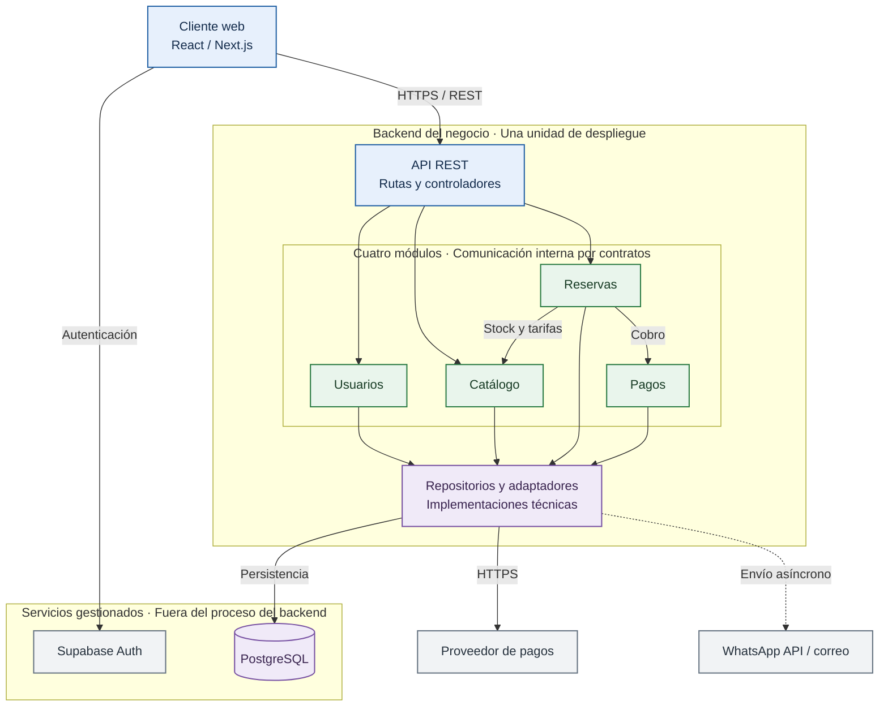

# Estilo Arquitectónico

## Monolito Modular con servicios gestionados

Para el desarrollo inicial de la aplicación web de reservas en Ayacucho, se ha seleccionado el estilo arquitectónico de **Monolito Modular** soportado por servicios gestionados de identidad y persistencia (Backend-as-a-Service). La modalidad de ejecución de la API, incluida una posible opción serverless, sigue pendiente de elección.

**Justificación:**
Al ser un proyecto desarrollado por un "Solo Developer", implementar arquitecturas distribuidas complejas (como Microservicios) generaría una sobrecarga innecesaria de configuración y mantenimiento. El Monolito Modular permite tener una única unidad de despliegue (fácil de subir a producción) pero manteniendo el código internamente ordenado por módulos de negocio, lo que facilita su evolución futura.

**Lectura:** flechas continuas = comunicación o colaboración; flecha discontinua = envío asíncrono. Azul = presentación/aplicación; verde = negocio; violeta = infraestructura; gris = personas o servicios externos. El diagrama representa una propuesta de diseño.

**Alcance del despliegue:** BaaS delega identidad y persistencia. El runtime y el alojamiento concretos de la API siguen pendientes; usar Supabase no determina por sí solo una ejecución serverless del código Node.js. Las flechas dentro del backend representan colaboración en ejecución, no importaciones entre capas.
