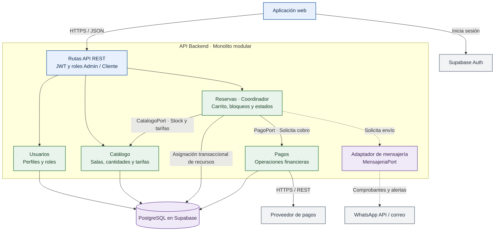

# Nivel 3 · Diagrama de componentes

> **Proyecto:** App Web de Reservas de Salas de Ensayo - Ayacucho  
> **Contenedor detallado:** API Backend (Monolito Modular)  
> **Modelo:** C4 · Nivel 3 de 4 · **Versión:** 1.0

---

## 1. Objetivo

Abrir el contenedor **API Backend** del nivel 2 y mostrar sus **componentes**: los módulos del monolito modular, la responsabilidad de cada uno, cómo se relacionan entre sí y cómo interactúan con la base de datos y la pasarela de pago.

| Aspecto | Descripción |
|---|---|
| Pregunta que responde | ¿Cómo se divide el backend por dentro y qué hace cada parte? |
| Audiencia | Arquitectos y desarrolladores |
| Qué es un componente | Un grupo de funcionalidades con una responsabilidad clara. En este proyecto, cada **módulo** lógico de negocio es un componente. |
| Nivel anterior | [nivel_2_diagrama_de_contenedores.md](nivel_2_diagrama_de_contenedores.md) |
| Siguiente nivel | [nivel_4_diagrama_de_codigo.md](nivel_4_diagrama_de_codigo.md) |

---

## 2. Diagrama

**Lectura:** flechas continuas = comunicación o colaboración; flecha discontinua = envío asíncrono. Azul = presentación/aplicación; verde = negocio; violeta = infraestructura; gris = personas o servicios externos. El diagrama representa una propuesta de diseño.

Los módulos se comunican en memoria mediante contratos. El adaptador de mensajería es infraestructura de la integración, no un quinto módulo. La exclusión por sala se propone mediante rangos `tsrange` y restricciones de exclusión; la asignación consistente de cantidades de equipos también requiere una operación transaccional. Estas garantías deben implementarse y probarse.

---

## 3. Componentes

| Componente | Responsabilidad | Funcionalidades principales | Carpeta en el código |
|---|---|---|---|
| **Rutas API REST** | Punto de entrada HTTP y autorización | Define las rutas (ej. `/api/v1/reservas`), valida el token JWT de Supabase y aplica Validación de Roles (RBAC - Admin/Cliente) antes de redirigir al módulo correcto. Las rutas administrativas exigen un rol de Admin validado en el token firmado y controlado por el servidor. | `src/api/` |
| **Módulo Usuarios** | Identidad y acceso | Gestiona los perfiles de los músicos (bandas) y administradores del local. | `src/modulos/usuarios/` |
| **Módulo Catálogo** | Gestión de recursos | CRUD de Salas (capacidad, precio) y Equipos extras (baterías, platillos, cables). | `src/modulos/catalogo/` |
| **Módulo Reservas** | Motor de negocio (Core) | Algoritmo **anti-overbooking**, armado del carrito, cálculo de costos y confirmación de horas. | `src/modulos/reservas/` |
| **Módulo Pagos** | Cobros | Integración externa para validar pagos de Yape o Plin. | `src/modulos/pagos/` |

---

## 4. Relaciones entre componentes

| Origen | Destino | Descripción | Tipo de comunicación |
|---|---|---|---|
| Rutas API | Módulos de negocio | Invoca los Casos de Uso desde los controladores después de validar el token y autorizar el rol requerido (RBAC - Admin/Cliente). | Llamada en memoria |
| Módulo Reservas | Módulo Catálogo | Verifica el stock de equipos extra mediante `CatalogoPort` y consulta si un equipo está activo y su precio actual para calcular el total. | Llamada en memoria (Interfaces) |
| Módulo Reservas | Módulo Pagos | Envía el total a cobrar y espera la confirmación (código de operación). | Llamada en memoria (Interfaces) |

---

## 5. Relaciones con bases de datos y sistemas externos

| Componente | Destino | Descripción | Protocolo | Patrón aplicado |
|---|---|---|---|---|
| Todos los módulos | Base de Datos (PostgreSQL) | Cada módulo lee y escribe sus propias tablas mediante el cliente de Supabase. | Acceso mediante repositorio; mecanismo por definir | Repository |
| Rutas API / Web | Servicio Auth (Supabase) | Verifica la validez del token de sesión. | HTTPS | Middleware |
| Módulo Pagos | Pasarela (Yape) | Solicita la validación del código de pago ingresado por el músico. | HTTPS/REST | Adapter |
| Módulo Reservas | Servicio Mensajería (WhatsApp API / Correo) | Envía comprobantes asíncronos mediante `MensajeriaPort` y su adaptador; los fallos se aíslan del resultado de la reserva. | HTTPS/REST | Adapter + Fire and Forget |

---

## 6. Reglas del Monolito Modular

| # | Regla | Motivo |
|---|---|---|
| 1 | Todos los componentes se despliegan juntos. | Al ser un Monolito (Next.js/Node), se facilita el despliegue para un solo desarrollador, operando bajo un mismo servidor. |
| 2 | Un módulo se comunica con otro a través de puertos/interfaces. | Evita el acoplamiento fuerte. Si Catálogo cambia su base de datos, Reservas no se ve afectado. |
| 3 | Un módulo no hace un `SELECT` o `UPDATE` directo a las tablas de otro módulo. | Mantiene la integridad. Si Reservas necesita saber el precio de una sala, le "pregunta" al módulo Catálogo. |
| 4 | Clean Architecture interna. | Cada módulo (como Reservas) organiza su código en Dominio, Aplicación e Infraestructura (Ver Nivel 4). |
