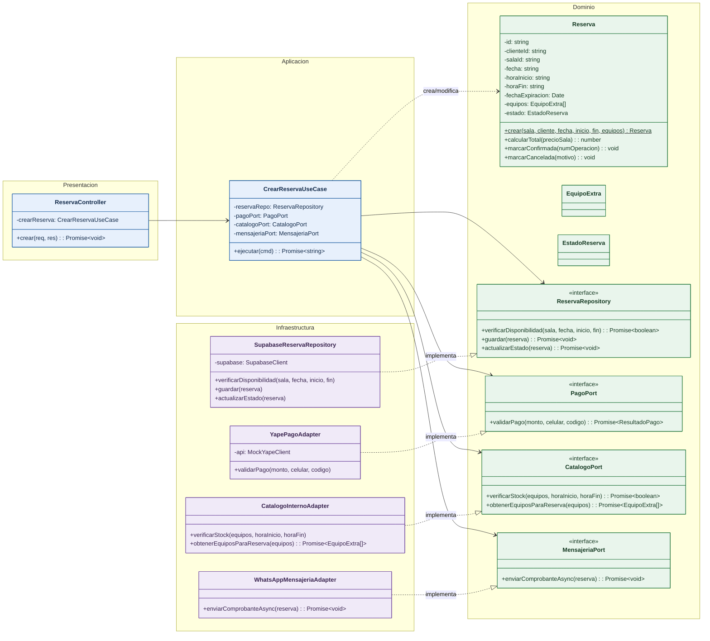
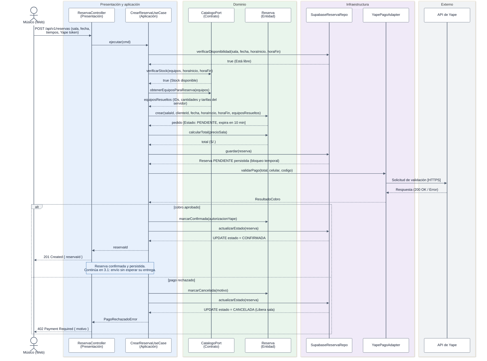
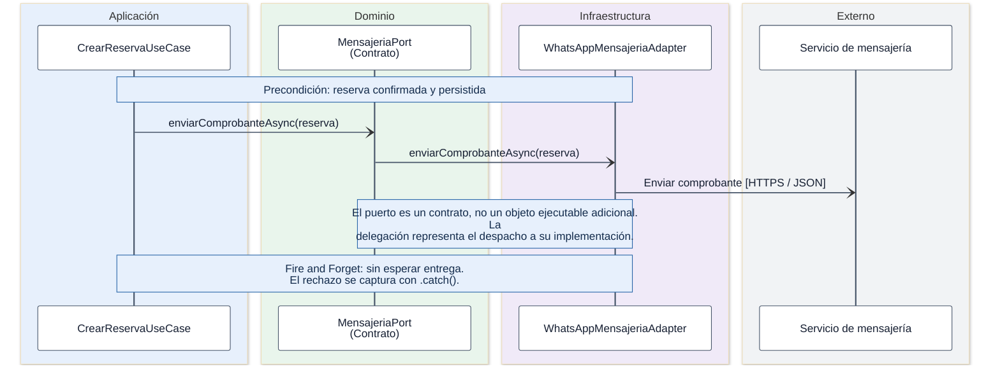

# Nivel 4 · Diagrama de código

> **Proyecto:** App Reservas Salas Ayacucho · **Módulos detallados:** Reservas y Pagos  
> **Modelo:** C4 · Nivel 4 de 4 · **Notación:** UML (Mermaid) · **Versión:** 1.1

---

## 1. Objetivo

Mostrar **cómo está organizado el código** de un componente clave (Módulo de Reservas): sus clases, interfaces y la forma en que colaboran. Se detalla el flujo **Crear Reserva**, que involucra las reglas de *anti-overbooking* transaccional y la integración con la pasarela de Yape.

| Aspecto | Descripción |
|---|---|
| Pregunta que responde | ¿Qué clases existen dentro de un módulo y cómo se relacionan? |
| Audiencia | Desarrolladores |
| Notación | UML (diagrama de clases y diagrama de secuencia usando código Mermaid) |
| Por qué solo estos módulos | El nivel 4 se dibuja solo para los componentes más críticos. Reservas concentra las reglas complejas de concurrencia y el motor de cobros |
| Nivel anterior | [nivel_3_diagrama_de_componentes.md](nivel_3_diagrama_de_componentes.md) |

---

## 2. Diagrama de Clases (Módulo Reservas)

El siguiente diagrama UML agrupa las clases por capa. Las flechas continuas muestran dependencias; `..>` indica uso o creación; `..|>` muestra implementación y apunta desde cada adaptador hacia su interfaz. El caso de uso depende de los contratos internos. Azul = presentación/aplicación; verde = dominio; violeta = infraestructura.

### 2.1 Capas de Clean Architecture

| Capa | Contiene | Regla |
|---|---|---|
| **Presentación** | Controladores | Traduce JSON/HTTP de la aplicación web a llamadas del caso de uso. |
| **Aplicación** | Casos de uso | Coordina el flujo transaccional y verifica el stock mediante `CatalogoPort`; no conoce la BD ni APIs externas. |
| **Dominio** | Entidades, objetos de valor, interfaces | Contiene las reglas anti-overbooking y estados de negocio. |
| **Infraestructura** | Repositorios y adaptadores | Implementa las interfaces usando Supabase, la API de Yape, el módulo Catálogo y mensajería externa. Se prevé que `SupabaseReservaRepository` delegue el bloqueo de concurrencia a las restricciones de exclusión de PostgreSQL (`tsrange`); la implementación y las pruebas están pendientes. |

---

## 3. Diagrama de Secuencia: Flujo Transaccional de Crear Reserva

`equipos` contiene objetos `{ equipoId, cantidad }`; `horaInicio` y `horaFin` son instantes ISO 8601 completos con fecha y desplazamiento horario. El puerto de stock es una consulta previa: la asignación de cantidades y sala debe validarse transaccionalmente al guardar.

La secuencia principal representa la asignación temporal antes del pago. La exclusión concurrente y la asignación de equipos son garantías propuestas que deben implementarse y probarse en persistencia. La notificación se detalla por separado en la continuación 3.1 para reducir la anchura del diagrama.

---

### 3.1 Continuación: comprobante asíncrono

Esta secuencia continúa exclusivamente después de confirmar y persistir la reserva en el flujo anterior. No se espera la entrega para devolver el resultado HTTP. La ubicación exacta del inicio de la tarea respecto de la respuesta depende del runtime: el ejemplo inicia la promesa antes de retornar el identificador. No se introduce un nuevo proceso ni una garantía de entrega duradera.

**Colores de las secuencias:** azul = presentación/aplicación; verde = dominio; violeta = infraestructura; gris = servicio externo. Las bandas agrupan responsabilidades, no procesos de despliegue. `CatalogoPort` también representa un contrato ejecutado por su adaptador interno.

**Lectura de las secuencias:** `->>` = llamada; `-->>` = retorno; `-)` = mensaje asíncrono. Fire and Forget aísla el fallo de entrega; no garantiza reintentos ni continuidad tras un reinicio.

---

## 4. Patrones y principios visibles en este nivel

| Elemento del diagrama | Patrón o principio |
|---|---|
| El flujo de Guardado Temporal | **Exclusión transaccional de intervalos** y asignación consistente de recursos, pendientes de implementación y pruebas. |
| `YapePagoAdapter` | Patrón **Adapter** (Aísla la API externa del núcleo). |
| `ReservaRepository` y `SupabaseReservaRepository` | Patrón **Repository** (El negocio no sabe que se usa PostgreSQL/Supabase). |
| `CatalogoPort` | Puerto del Dominio para verificar stock sin acoplar Reservas a la implementación de Catálogo. |
| El `CrearReservaUseCase` recibe interfaces (`ReservaRepository`, `PagoPort`, `CatalogoPort`, `MensajeriaPort`), no clases concretas | Principio de **Inversión de Dependencias** (Letra 'D' de SOLID). |
| Cada clase hace una sola cosa (Controlador responde HTTP, Entidad calcula total) | Principio de **Responsabilidad Única** (Letra 'S' de SOLID). |
