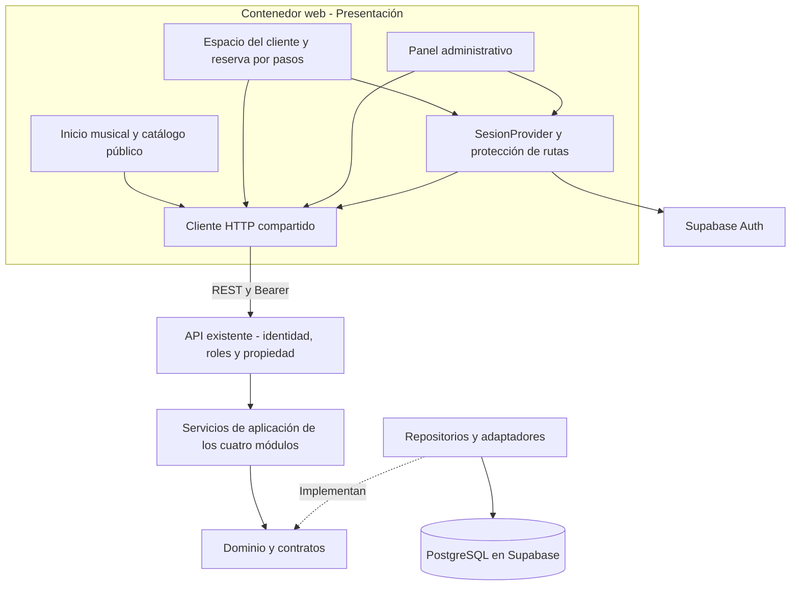

# Interfaces por rol de ENSAYA

Actualización posterior: [interfaz intuitiva integrada y validación de 25 pruebas de navegador](INTERFAZ-INTUITIVA.md). Las cifras y capturas anteriores conservan su fecha histórica.

La presentación actual usa un [tema musical oscuro compartido](TEMA-OSCURO.md). Las capturas de `evidencias/interfaces` y `evidencias/recorrido-real` se conservan como registros del diseño previo; las nuevas capturas visuales están separadas en `evidencias/tema-oscuro` y usan fixtures controlados.

## Organización implementada

La interfaz se divide en tres experiencias: sitio público, espacio del músico y administración. Las páginas de Next.js están en `src/app`; los componentes y el estado de presentación están en `src/cliente/presentacion`, agrupados por autenticación, cliente, administrador, reservas y piezas compartidas. La pantalla monolítica `estudio.tsx` fue sustituida por estas páginas.

| Experiencia | Rutas |
|---|---|
| Pública | `/`, `/reservar`, `/ingresar`, `/registro` |
| Cliente | `/cliente`, `/cliente/reservas`, `/cliente/reservas/[id]` |
| Administración | `/admin`, `/admin/reservas`, `/admin/reservas/[id]`, `/admin/catalogo`, `/admin/bloqueos`, `/admin/pagos`, `/admin/comprobantes` |
| API y documentación | `/api/v1`, `/docs`; contratos existentes conservados. |

El cliente reserva por pasos: horario → sala → equipos → revisión → pago. La selección se guarda temporalmente en sessionStorage para continuar después de iniciar sesión. Solo se guardan IDs, cantidades, intervalo, progreso y referencia de la reserva pendiente; nunca credenciales, tokens o precios definitivos. La reserva pendiente se recupera únicamente para su propietario y se vuelve a consultar en la API. Cerrar sesión elimina el borrador. El servidor conserva la autoridad sobre tarifas, stock, estados y vencimiento.

El administrador dispone de menú lateral, agenda filtrable, detalle, catálogo con formularios separados, bloqueos independientes, pagos y comprobantes. Los precios se editan en soles y se convierten a céntimos al enviar la petición. Las desactivaciones, cancelaciones y conciliaciones requieren confirmación en la propia interfaz. El resumen administrativo cuenta exclusivamente los registros recibidos, indicando el límite de 200; no presenta totales globales ni ingresos bancarios.

## Relación con Clean Architecture y C4

Las interfaces son componentes del mismo contenedor web; no crean monolitos separados ni microservicios. Los componentes de navegador no importan repositorios, composición de backend, SQL ni casos de uso internos. Comparten tipos de datos y consumen exclusivamente la API. Los módulos Usuarios, Catálogo, Reservas y Pagos, sus contratos HTTP y las tablas no se modificaron para este rediseño.

## Sesión y autorización

Supabase mantiene la sesión del navegador. El cliente HTTP obtiene su access token y solicita `/api/v1/yo`; el servidor valida el token y devuelve el rol de `perfiles`. Tras acceder, CLIENTE va a `/cliente` y ADMIN a `/admin`, salvo retorno permitido a una ruta propia o a `/reservar`. Se descartan destinos externos y rutas de otro rol.

Los layouts privados muestran carga hasta verificar sesión y rol. Si no existe sesión, redirigen a ingresar; si el rol es distinto, redirigen a su espacio. Sus componentes hijos y consultas privadas no se montan antes de autorizar. Esto mejora la experiencia; la seguridad real permanece en los endpoints del servidor. No se añadió ningún modo de acceso alternativo, usuario de prueba ni bypass de JWT en producción.

Los callbacks de Supabase no esperan llamadas asíncronas de autenticación dentro del callback; programan la actualización fuera de él. Cerrar sesión retira la sesión, elimina el borrador y carga el inicio en un documento nuevo para evitar carreras con redirecciones del layout anterior.

## Guion de demostración

1. Abrir `/`: observar salas y equipos reales; las imágenes del estudio son ilustraciones, no fotografías.
2. Ir a reservar, elegir horario y sala, añadir extras y revisar el importe. Sin sesión, el acceso conserva la selección.
3. Iniciar sesión como CLIENTE; continuar la selección, reservar y completar pago simulado. Consultar el detalle desde Mis reservas y cancelar con motivo cuando corresponda.
4. Iniciar sesión como ADMIN; revisar resumen y agenda, filtrar, abrir detalle y gestionar cancelación.
5. En catálogo, mostrar precio en soles y estado; en bloqueos, seleccionar sala e intervalo sin salir del panel.
6. Revisar pagos inciertos y comprobantes; demostrar que un fallo de envío no cambia la confirmación.
7. Revisar móvil y cierre de sesión. Un cliente que visite `/admin` debe regresar a su espacio.

## Pruebas y límites

Las pruebas de navegador usan Chrome. Los recorridos públicos leen el catálogo de la API real disponible en localhost; los recorridos privados interceptan sesión y peticiones con fixtures controlados, sin modificar Supabase. Las capturas de cliente y administrador generadas por esos tests corresponden a datos de prueba. No se presentan como evidencia de dos sesiones reales contra Supabase.

La demostración autenticada real posterior se completó con ADMIN y CLIENTE confirmados, ingreso manual y API/Supabase reales. Se verificaron navegación y redirección del cliente, reserva con equipo, pago simulado aprobado y cancelación final para liberar recursos. El [informe real](evidencias/recorrido-real/resumen.json) se distingue de los fixtures automatizados. El rediseño no cambia las integraciones simuladas ni el resultado de carga de 2.000 VUs documentado en VALIDACION.md.

Comandos: `npm run typecheck`, `npm run build`, `npm run test:verify` y `npm run test:browser`. Los reportes de interfaz y capturas se guardan en `test-results` y su evidencia seleccionada se conserva en `docs/sprint-2/evidencias/interfaces`.
